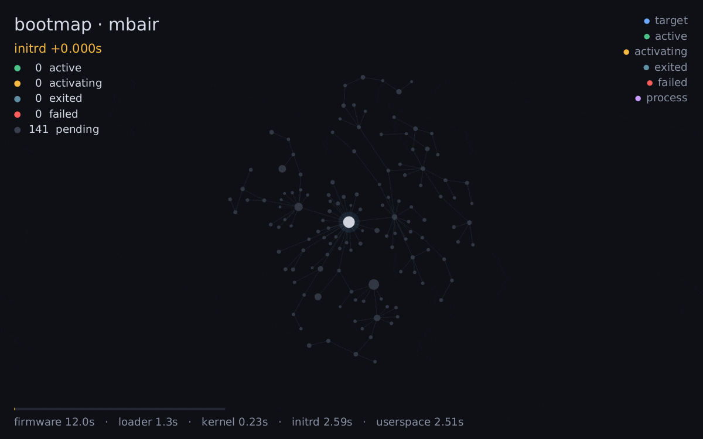

# bootmap

[](https://github.com/pgattic/bootmap/actions/workflows/ci.yml)

**Watch your Linux system boot, as a living graph.**



bootmap replaces the scrolling wall of boot messages with a picture of what
systemd is actually doing. The system sits at the center, services and other
units float around it connected by their dependencies, and each one lights up
as it starts. You can see at a glance what is running, what is still waiting,
and what is holding the boot up.

## Features

- **Live at boot.** Draws straight to the screen from the first second, before
  any desktop exists, and hands over cleanly to your login screen.
- **The whole boot.** Can start in the initrd and follow the boot into the real
  system without a flicker.
- **Shows what matters.** Labels follow what is happening: what is starting,
  what failed, and once the boot is done, what was slowest.
- **Replay any boot.** Every boot is recorded; replay it later in a window,
  pause it, scrub through it and hover units for details.
- **Shutdown too.** The graph comes back when you shut down or reboot, showing
  what is still stopping.
- **Unlocks encrypted disks.** Passphrase prompts appear right over the graph.
- **Make it yours.** Pick a theme, change the colors and text size, hide what
  you do not need, and put your own logo in the middle.
- **Any screen.** Sharp on high-resolution displays, mirrored to every
  connected monitor.

## Try it

On any Linux system running systemd, with [Nix](https://nixos.org):

```sh
nix run github:pgattic/bootmap -- view
```

This opens a window showing the current boot. On a system with bootmap
installed, `bootmap view /var/log/bootmap/last.json` replays the last boot from
start to finish.

## Install on NixOS

Add bootmap to your flake and enable it:

```nix
{
  inputs.bootmap.url = "github:pgattic/bootmap";

  outputs = { nixpkgs, bootmap, ... }: {
    nixosConfigurations.myhost = nixpkgs.lib.nixosSystem {
      modules = [
        bootmap.nixosModules.default
        {
          services.bootmap = {
            enable = true;
            initrd = true;
          };
        }
      ];
    };
  };
}
```

Rebuild and reboot. For more info on `services.bootmap.initrd`, see
[starting in the initrd](docs/usage.md#starting-in-the-initrd).

## Documentation

- [Usage](docs/usage.md): the viewer, every NixOS option, appearance, encrypted disks,
  monitors, troubleshooting.
- [How it works](docs/how-it-works.md): how bootmap reads the boot, draws it,
  and stays out of the way.
- [Development](docs/development.md): building, testing and the code layout.

## Credits

Inspired by [bootvine](https://codeberg.org/wvhulle/bootvine), which shows the
boot as a tree in the terminal.

## License

[MIT](LICENSE)
